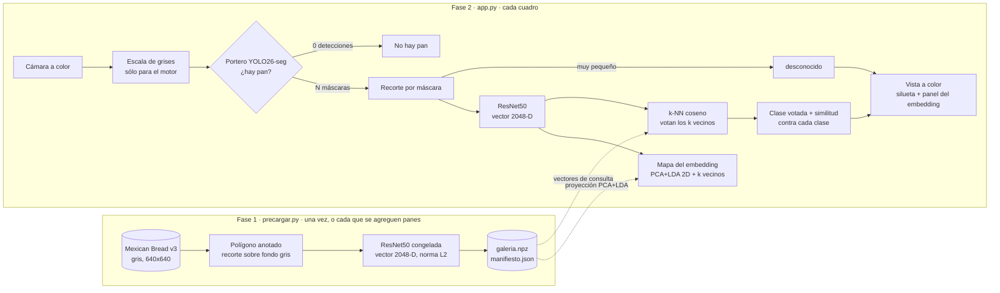

# Proyecto 1 · Caja asistida de panadería

**Aprendizaje Automático III, Semestre VII.** Detectar o segmentar cada pan de una bandeja, identificar su clase, contar las instancias visibles y estimar un ticket cuando existan precios. No procesa pagos ni es una caja autónoma certificada.

La red aprende **dónde está cada pan y qué clase es**. `precios.py` decide su precio; `cobro.py` calcula `cantidad × precio`. Cambiar un precio no requiere reentrenar. Los precios son ficticios y usan centavos enteros: dos conchas de $12, un bolillo de $5 y una dona de $15 suman **$44 MXN**.

## Estado experimental actual

El primer experimento con **YOLO26s-seg + Mexican Bread** se conserva como referencia, pero las pruebas externas mostraron problemas claros de generalización en color, escala y clasificación.

El segundo experimento usa **YOLO26m-detect + Bread Detector v2**. Su `best.pt` está publicado en `models/` y se conserva como referencia. Detecta 15 clases. `aplicacion/precios.py` relaciona cada etiqueta del detector con un nombre en español y un precio ficticio en centavos, además de conservar las 11 clases del experimento anterior. Por ejemplo, `wheat-bread` se muestra como "Pan de trigo" con un precio de demostración de $15 MXN. Una clase desconocida se cuenta, pero invalida el total.

El tercer experimento, **motor de embedding**, separa las dos preguntas: YOLO26-seg Mexican Bread sólo decide **si hay pan y dónde**, y una galería de embeddings ResNet50 decide **qué pan es**, como en reconocimiento facial. Ver [Motor de embedding en vivo](#motor-de-embedding-en-vivo).

Documentación:

- [Experimento 1: qué funcionó y qué falló](docs/01_experimento_segmentacion_mexican_bread.md)
- [Plan 2: entrenamiento de detección](docs/02_plan_detector_pan.md)
- [Índice de documentación](docs/README.md)

Runners directos del nuevo experimento:

```text
utils/download_bread_detector.py
entrenamiento/train_detector.py
```

## Modelos entrenados incluidos

La rama `main` publica actualmente **12 checkpoints finales**: dos pesos previos conservados por compatibilidad y una matriz nueva de **10 modelos YOLO26**.

Los pesos previos son:

```text
models/aprendizaje_automatico_iii/proyecto_1/bread_detector_best.pt
models/aprendizaje_automatico_iii/proyecto_1/yolo26s_mexican_bread_seg_best.pt
```

La matriz nueva cubre los tamaños `n`, `s`, `m`, `l` y `x` para las dos tareas:

```text
yolo26{n,s,m,l,x}_bread-v2_det/weights/best.pt
yolo26{n,s,m,l,x}_mexican-v3_seg/weights/best.pt
```

`bread-v2_det` corresponde a **object detection** con Bread Detector v2 y `mexican-v3_seg` a **instance segmentation** con Mexican Bread v3. Cada `best.pt` contiene el modelo entrenado completo y se carga directamente para inferencia; no se combina con los pesos base.

`app.py` es ahora la demo del [motor de embedding](#motor-de-embedding-en-vivo). Para usar sólo YOLO, con su propia clase, pasa la ruta de cualquier checkpoint a la CLI:

```bash
uv run python -m semestre_vii.aprendizaje_automatico_iii.proyecto_1 caja \
  --source data/aprendizaje_automatico_iii/proyecto_1/concha.jpg \
  --model models/aprendizaje_automatico_iii/proyecto_1/yolo26s_mexican-v3_seg/weights/best.pt \
  --sin-ventana
```

La frontera `ModeloYOLO` acepta tanto checkpoints `detect` como `segment` y los traduce al mismo contrato `Lectura`, por lo que un consumidor interno puede cambiar de modelo sin implementar dos pipelines de inferencia. El catálogo completo, la convención de nombres y ejemplos de consumo desde Python están documentados en [`models/aprendizaje_automatico_iii/proyecto_1/README.md`](../../../../models/aprendizaje_automatico_iii/proyecto_1/README.md).

Los checkpoints temporales, incluido `last.pt`, permanecen fuera de Git. Los pesos finales se publican mediante Git LFS.

## Motor de embedding en vivo

Dos fases separadas, como en reconocimiento facial: primero se **precarga** una galería con un vector por pan anotado; después, en vivo, cada pan detectado se **consulta** contra esa galería.



La cámara se ve a color, pero el portero y el encoder reciben el cuadro en gris, igual que las imágenes de Mexican Bread v3 con las que se entrenó YOLO y se construyó la galería. El dominio lo dicta el campo `gris` del manifiesto, no un ajuste de la demo: para comparar a color hay que precargar otra galería con `CONSTRUCCION__GRIS=false`.

**Mapa del embedding.** Una segunda ventana muestra la galería proyectada a 2D: primero PCA a 50 dimensiones y luego LDA (análisis discriminante lineal), ajustados en el precalentamiento. Sin la PCA previa, LDA en 2048 dimensiones se sobreajusta y los panes nuevos caen fuera de su cluster. Cada punto es un pan de `train`, con el color de su clase, el mismo que la silueta en la cámara; la leyenda lateral los nombra. Si un pan en vivo cae fuera del rango de la galería, se dibuja en el borde con la marca "fuera del mapa". Cada pan en vivo aparece como un punto con borde blanco, y unas líneas lo unen con sus k vecinos reales. La proyección es orientativa: separa los clusters, pero las distancias en 2D no son el coseno; las líneas sí apuntan a los vecinos que decidieron la clase. Con la barra espaciadora se congelan la cámara y el mapa, y con `S` se guardan los dos.

1. **Portero:** YOLO26-seg Mexican Bread con `agnostic_nms`, tamaño `l` por defecto. Fusiona detecciones solapadas de clases distintas en un solo pan y su clase se descarta. Con la entrada en gris y 8 fotos externas (`concha.jpg` y 7 de bolillos), `l` detectó pan en 5 (incluida la concha) y `x` en 7 (sin la concha). `l` tarda unos 95 ms por cuadro en MPS y `x` unos 200 ms.
2. **Recorte** (`motor_embedding/recorte.py`): pan sobre fondo gris, margen de 6 % y cuadrado. Precarga e inferencia usan exactamente esta función; si difieren, los vectores dejan de ser comparables.
3. **Encoder** (`motor_embedding/encoder.py`): ResNet50 ImageNet V2 congelada, 2048 dimensiones con norma L2. Unos 20 ms por pan en MPS.
4. **Galería** (`motor_embedding/vecinos.py`): k-NN exacto por coseno con k=3 y votación. YOLO ya decidió que es pan, así que por defecto no hay rechazo: siempre gana la clase más votada. Además se calcula la similitud con el pan más parecido de **cada** clase, que es lo que muestra hacia dónde se carga la consulta. `desconocido` sólo aparece si el pan es demasiado pequeño para recortarlo, o si se fija un `umbral` y ni el vecino más cercano lo alcanza.

La galería se construye sólo con `train`. `val` mide la exactitud y calibra el umbral: el percentil 5 de la similitud de los aciertos. Ambos quedan en `manifiesto.json`. La exactitud registrada es la del k-NN sin rechazo: con el umbral activo, cerca del 5 % de esos aciertos sale como desconocido. Agregar una clase nueva es volver a precargar con sus fotos; no se reentrena nada. Límite: el portero sólo conoce las 11 clases de Mexican Bread, así que un pan muy distinto puede no detectarse.

**Precarga.** Es el único paso que necesita credencial: descarga Mexican Bread v3 con la API de Roboflow. Copia `.env.example` como `.env` en esta misma carpeta (Git lo ignora) y pega tu `ROBOFLOW_API_KEY`. `precargar.py` lee ese `.env` solo:

```bash
uv run src/semestre_vii/aprendizaje_automatico_iii/proyecto_1/precargar.py
```

El dataset queda en `data/aprendizaje_automatico_iii/proyecto_1/mexican-v3/` y la galería en `data/aprendizaje_automatico_iii/proyecto_1/galerias/resnet50_mexican-v3/`. Si el dataset ya existe, no vuelve a usar la red. Por defecto la galería usa Bolillo, Concha, Cuernito y Dona (`AjustesCarga` en `precargar.py`); con `clases=None` usa las 11 del dataset.

**Ajustes.** Todo lo configurable vive agrupado en `configuracion.py`, con pydantic-settings, en tres clases:

1. `Ajustes`: lo común (dispositivo y carpeta de la galería).
2. `AjustesDemo`: lo de `app.py` (fuente, portero, umbral). Es la única que lee el CLI.
3. `AjustesPrecarga`: lo de `precargar.py` (clave de Roboflow y el grupo `construccion`). Nunca lee el CLI, así que la clave no puede quedar en el historial de la terminal.

`app.py` y `precargar.py` las heredan en `AjustesApp` y `AjustesCarga`, con sus parámetros a la vista al inicio del archivo: para cambiar el tamaño del portero o el umbral de la demo, se edita ahí. Gana el primero que esté definido: CLI de `app.py`, variable de entorno, `.env`, la clase del script y por último `configuracion.py`. Una variable como `PORTERO__CONFIANZA` cambia sólo ese campo y respeta el resto de lo fijado en la clase. Los grupos se separan con punto en el CLI y con doble guion bajo en el entorno:

| Clase | Ajuste | Por defecto | CLI de `app.py` | Entorno o `.env` |
| --- | --- | --- | --- | --- |
| común | dispositivo | `auto` | `--dispositivo mps` | `DISPOSITIVO` |
| común | carpeta de la galería | `galerias/resnet50_mexican-v3` | `--galeria <ruta>` | `GALERIA` |
| demo | fuente | `0` (cámara) | `--fuente foto.jpg` | `FUENTE` |
| demo | tamaño del portero | `l` | `--portero.tamano x` | `PORTERO__TAMANO` |
| demo | confianza del portero | `0.35` | `--portero.confianza 0.5` | `PORTERO__CONFIANZA` |
| demo | imgsz del portero | `640` | `--portero.imgsz 960` | `PORTERO__IMGSZ` |
| demo | umbral de desconocido | sin rechazo | `--umbral 0.6` | `UMBRAL` |
| precarga | clave de Roboflow | ninguna | no existe | `ROBOFLOW_API_KEY` |
| precarga | dataset | `mexican-v3` | no existe | `CONSTRUCCION__DATASET` |
| precarga | clases | las 4 de la demo | no existe | `CONSTRUCCION__CLASES` |
| precarga | gris | `true` | no existe | `CONSTRUCCION__GRIS` |

Los tipos cerrados son `StrEnum`: `Tamaño` (configuracion.py), `ClasePan` (esquemas/pan.py, nombres exactos del dataset) y `Tarea` (modelo/yolo.py, `detect` o `segment`). Un valor fuera del catálogo falla al cargar los ajustes o la galería, no a media demo. La clave viaja como `SecretStr`: no aparece en `print`, logs ni tracebacks. `.env.example` lista todas las variables.

**Demo en vivo.** Carga la galería, precalienta YOLO y ResNet con una pasada en vacío y abre la cámara:

```bash
uv run src/semestre_vii/aprendizaje_automatico_iii/proyecto_1/app.py
```

El portero es siempre Mexican Bread segmentación: un detector de cajas metería fondo al recorte y la galería son siluetas. Todas las opciones están en la tabla de ajustes y `app.py --help` las lista. La demo no muestra ticket: el panel lateral enseña, por cada pan, la clase votada, cuántos de los k vecinos la eligieron y una barra por clase con la similitud coseno contra el pan más parecido de esa clase. Cuanto más separada está la barra ganadora de la segunda, más clara es la decisión. La similitud no es una probabilidad. El ticket y los precios siguen en el modo `caja` de la CLI.

## Ejecución local de entrenamiento e inferencia

**El entrenamiento y la inferencia no usan el SDK de Roboflow ni API keys.** La única excepción es `precargar.py`, descrita arriba. Las utilidades de descarga sólo abren la página pública en el navegador, esperan el ZIP descargado a tu PC y después lo importan localmente. El entrenamiento y la inferencia siguen siendo locales.

El dataset sigue siendo una entrada necesaria para entrenar: un enlace no contiene los archivos en tu disco. Obtén una exportación ZIP con imágenes y etiquetas YOLO y guárdala en tu PC una vez. Si ya tienes una carpeta exportada, úsala directamente. **Los datasets y archivos intermedios no están incluidos en Git; sólo se publican los mejores pesos en `models/`.**

Esto no promete una instalación completamente desconectada: `uv` necesita obtener las dependencias, y Ultralytics puede descargar los pesos iniciales de YOLO/SAM cuando faltan. Esas descargas no son inferencia remota ni requieren la API key eliminada. La cámara, las imágenes y el entrenamiento del proyecto no se envían al servicio Roboflow.

## Arquitectura

```text
proyecto_1/
├── app.py                  # Demo en vivo: portero YOLO + galería de embeddings
├── precargar.py            # Fase 1: descarga y construye la galería
├── .env.example            # Variables de Ajustes; ROBOFLOW_API_KEY sólo la usa precargar.py
├── __main__.py             # CLI opcional
├── configuracion.py        # Ajustes, AjustesDemo, AjustesPrecarga; rutas y CPU / MPS / CUDA
├── aplicacion/
│   ├── runtime.py          # Flujo cámara/foto/video → modelo → resultado
│   ├── interfaz.py         # Visualización y capturas
│   ├── mapa.py             # Mapa 2D del embedding en vivo (PCA+LDA)
│   ├── cobro.py            # Conteo, ticket y estabilidad
│   └── precios.py          # Precios ficticios
├── esquemas/               # Contratos Pydantic entre piezas
│   ├── deteccion.py        # Instancia y Lectura de un fotograma
│   ├── embedding.py        # Vector unitario de un pan
│   ├── reconocimiento.py   # Vecinos y clase elegida por la galería
│   ├── galeria.py          # Galería en disco y su manifiesto
│   └── pan.py              # ClasePan: catálogo StrEnum de Mexican Bread
├── modelo/
│   └── yolo.py             # Traducción de cajas o máscaras a instancias
├── motor_embedding/
│   ├── recorte.py          # Recorte compartido por ambas fases
│   ├── encoder.py          # ResNet50 congelada
│   ├── vecinos.py          # k-NN coseno, votación y umbral
│   ├── precarga/
│   │   ├── roboflow.py     # Descarga con ROBOFLOW_API_KEY
│   │   └── construir.py    # Dataset → recortes → galería
│   └── inferencia/
│       └── reconocedor.py  # Portero → recorte → encoder → galería
├── entrenamiento/
│   ├── datos.py            # Lectura/auditoría de datasets YOLO
│   ├── preparacion.py      # Preparación de segmentación
│   ├── segmentacion.py     # Entrenamiento/evaluación del experimento 1
│   ├── detector.py         # Entrenamiento del experimento 2
│   ├── prepare_segmentacion.py
│   ├── train_segmentacion.py
│   └── train_detector.py
├── utils/
│   ├── descargas.py        # Navegador + detección de ZIP descargado
│   ├── importacion.py      # ZIP/carpeta → dataset local
│   └── download_bread_detector.py
├── diagnostico/
│   ├── modelo.py           # Diagnóstico del checkpoint
│   └── gpu.py              # Diagnóstico CUDA/MPS
└── docs/
    ├── 01_experimento_segmentacion_mexican_bread.md
    ├── 02_plan_detector_pan.md
    └── 03_datasets_candidatos.md
```
Los datos originales, derivados y capturas van a `data/aprendizaje_automatico_iii/proyecto_1/`, fuera de `src` y excluidos de Git. Las corridas nuevas dejan sus archivos intermedios locales en `models/`; sólo se publican sus mejores pesos. No hay base de datos ni API web.

## Instalación

Desde la raíz de `semestre_vii`, sólo si aún no instalaste las dependencias:

```bash
uv add ultralytics opencv-python pyyaml
uv sync
```

Si esos comandos ya terminaron correctamente, no necesitas reinstalar nada. Se conservan el Python y las dependencias fijadas por el repositorio; `uv add` actualiza el lockfile localmente. Para la cámara usa OpenCV con interfaz, no la variante headless.

Para abreviar los comandos de esta guía, define un alias en la terminal actual:

```bash
alias pan='uv run python -m semestre_vii.aprendizaje_automatico_iii.proyecto_1'
pan --help
pan precios
```

El alias es opcional. Su equivalente completo es `uv run python -m semestre_vii.aprendizaje_automatico_iii.proyecto_1`. Si una terminal anterior sigue esperando la clave, cancela esa ejecución con **Ctrl+C** antes de actualizar el código.

## Importar un dataset de tu PC

Con el ZIP local, sustituyendo el nombre por el archivo real:

```bash
pan importar "$HOME/Downloads/mexican-bread.zip"
pan inspeccionar --verificar-fugas
```

También admite una carpeta o su YAML:

```bash
pan importar "$HOME/Downloads/mexican-bread"
pan importar "$HOME/Downloads/mexican-bread/data.yaml"
```

Son **alternativas**, no tres pasos consecutivos. El importador copia las imágenes y etiquetas, conserva los README/licencias de la raíz y `procedencia.json`, y deja intacto el origen. Detecta un `data.yaml` anidado dentro del ZIP; si hay varios, indica el YAML exacto desde una carpeta ya extraída. No descarga nada, no pide claves, no sobrescribe un destino existente y limpia sus archivos temporales si falla.

La copia queda preparada en:

```text
data/aprendizaje_automatico_iii/proyecto_1/dataset/
├── data.yaml
├── train/images/ + train/labels/
├── val/images/   + val/labels/
└── test/images/  + test/labels/  # cuando el dataset incluye test
```

El YAML generado usa rutas relativas, así que la copia no depende del ZIP ni de carpetas temporales. Las clases mantienen su orden original. Las importaciones exigen un dataset autocontenido: rechazan archivos externos, rutas inseguras, enlaces de ZIP, nombres duplicados y ZIPs de más de 20 GiB o 100,000 entradas.

**No necesitas copiar el dataset al repositorio** si prefieres dejarlo en otra ubicación. Puedes omitir `importar` y pasar el YAML local:

```bash
pan inspeccionar --data "$HOME/Downloads/mexican-bread/data.yaml" --verificar-fugas
pan preparar --data "$HOME/Downloads/mexican-bread/data.yaml" --con-sam --device mps
```

`--data` admite la estructura YOLO con carpetas `images` y `labels`, no COCO JSON ni listas de imágenes. `--destino` permite importar a otra carpeta; usa después el `--data` que imprime el comando.

La ruta antigua `data/aprendizaje_automatico_iii/proyecto_1/roboflow/data.yaml` se sigue reconociendo si ya existe y no hay un `dataset/data.yaml` nuevo. Ese nombre es sólo compatibilidad de archivos, no una conexión al servicio. Si existe `segmentado/data.yaml`, inspección, revisión, entrenamiento y evaluación lo prefieren por defecto. **Para comparar varios datasets o evitar seleccionar una preparación anterior, indica `--data` explícitamente.**

## Antes de entrenar: cajas no son máscaras

Fuente de referencia: [Mexican Bread de JPIA](https://universe.roboflow.com/jpia/mexican-bread), versión 3. No deduzcas el tipo de anotación sólo de la vista previa del sitio: **`inspeccionar` lee las etiquetas reales** y reporta imágenes, cajas, polígonos y cantidades por clase.

```text
0 0.50 0.50 0.20 0.30                      # caja: clase + centro/ancho/alto
0 0.10 0.10 0.80 0.10 0.80 0.80 0.10 0.80 # polígono: clase + puntos
```

YOLO26-seg requiere polígonos por instancia. Un exportador llamado `yolov8` describe el formato de etiquetas; no obliga a utilizar YOLOv8 ni transforma cajas en máscaras. El código lee los IDs y nombres desde el YAML, sin asumir el orden del diccionario de precios.

La auditoría rechaza clases inválidas, coordenadas no finitas, polígonos degenerados y etiquetas faltantes. Los negativos deben tener un `.txt` vacío explícito. `--verificar-fugas` detecta imágenes idénticas entre splits; no detecta por sí solo fotos casi iguales o sesiones de captura compartidas.

## Preparar y revisar las máscaras

Cuando las etiquetas ya contienen polígonos:

```bash
pan preparar
```

Cuando contienen cajas:

```bash
pan preparar --con-sam --device mps
```

La segunda alternativa utiliza cada caja como prompt de **SAM 2.1 Tiny local**, conserva la clase y produce propuestas de máscaras. No convierte las cuatro esquinas de una caja en ground truth. Procesa la exportación completa y conserva la separación train/val/test. No se activa sin `--con-sam` ni sobrescribe `segmentado`; para otro experimento usa otro `--destino`.

Las propuestas pueden incluir fondo, unir panes o cortar bordes. Quedan identificadas en `procedencia.json`; usarlas requiere `--aceptar-pseudoetiquetas`. Ese flag reconoce su procedencia, **no certifica su calidad**. Revisa y corrige las máscaras con una herramienta de anotación antes de evaluar resultados como si fueran etiquetas humanas.

```bash
pan revisar --split train --destino data/aprendizaje_automatico_iii/proyecto_1/revision/train
pan revisar --split val --destino data/aprendizaje_automatico_iii/proyecto_1/revision/val
pan revisar --split test --destino data/aprendizaje_automatico_iii/proyecto_1/revision/test
```

Cada comando exporta 20 ejemplos distribuidos por el split. `--limite 0` exporta todos. Son anotaciones superpuestas, **no predicciones de YOLO**; revisar veinte ejemplos no equivale a revisar todo el dataset. Omite test si tu exportación no lo incluye.

## Entrenar y publicar desde el servidor

Con los datasets en `~/Descargas/` y sus archivos `data_local.yaml`, `ENTRENAMIENTOS` en
`scripts/entrenar_panes.py` define las diez combinaciones. El script recorre los nombres indicados;
Ultralytics guarda `best.pt` y, al terminar cada corrida, publica sólo ese peso en `main` mediante Git LFS:

```bash
.venv/bin/python scripts/entrenar_panes.py yolo26s_bread-v2_det yolo26m_mexican-v3_seg
```

El wrapper `scripts/entrenar_y_publicar.sh` sigue disponible para la cola ya iniciada en Linux.
Cada combinación tiene una carpeta con versión, tamaño, dataset y tarea. `last.pt` y las salidas
temporales permanecen locales. Si el entrenamiento o el push falla, el script termina con error y
conserva la corrida para diagnóstico.

## Experimento 1: entrenar YOLO26-seg en tu equipo

Primero una prueba del recorrido, no un modelo confiable para cobrar:

```bash
pan entrenar --device mps --epochs 1 --batch 2 --fraction 0.02 --aceptar-pseudoetiquetas
```

Después, un primer experimento completo:

```bash
pan entrenar --device mps --epochs 30 --batch 4 --tamano n --aceptar-pseudoetiquetas
```

Omite `--aceptar-pseudoetiquetas` si no utilizaste SAM. Se rechaza entrenar segmentación con cajas. Empieza con `yolo26n-seg.pt`; puedes comparar `--tamano s` después de obtener una línea base. Los pesos preentrenados no reconocen automáticamente las clases mexicanas: se adaptan durante el entrenamiento.

`--device auto` selecciona CUDA, MPS o CPU según disponibilidad. En el Mac usa `mps`; ante falta de memoria reduce `--batch 2` o `--batch 1`. `--device cpu` es otra opción. Se usa `workers=0`, `cache=False` y semilla 42; la semilla no garantiza igualdad bit a bit entre dispositivos o versiones.

Cada ejecución crea un directorio propio en `runs/` con pérdidas, métricas y `weights/best.pt` / `weights/last.pt`. `experimento.json` registra configuración, procedencia y versiones. `ultimo_modelo.txt` apunta al último `best.pt` generado correctamente, incluso si era una prueba: **no significa que ese checkpoint sea bueno**. Usa `--model` para elegir otro.

## Abrir la caja local

```bash
pan caja --source 0 --device mps
```

También admite foto o video:

```bash
pan caja --source /ruta/bandeja.jpg --device mps
pan caja --source /ruta/video.mp4 --device mps
pan caja --source /ruta/bandeja.jpg --sin-ventana
```

Se muestran cajas o máscaras según el checkpoint, clase, confianza, piezas, subtotales disponibles, FPS e inferencia en milisegundos. **Espacio** pausa; **S** guarda una estimación JPG + JSON; **Q** o Escape cierra. Las fotos se guardan automáticamente. `--source 1` selecciona otra cámara y `--conf 0.65` cambia el umbral. En macOS concede permiso de cámara a la terminal/IDE que lance Python.

Se cuenta sólo el fotograma actual, sin acumular observaciones entre frames. La misma concha durante diez segundos sigue siendo una concha; al vaciar la bandeja, el total vuelve a cero. La estabilidad indica que el conteo se repitió cinco frames, **no que sea correcto**. No hay tracking acumulativo ni procesamiento de pagos.

Una clase sin precio no vale cero: invalida el total. Las 15 clases del detector tienen nombres en español y precios de demostración editables en `aplicacion/precios.py`. El importe depende de las detecciones del modelo y puede ser erróneo si clasifica o cuenta mal. El límite actual es 100 instancias por imagen.

## Evaluar el experimento 1 de segmentación

`pan evaluar` sólo acepta el dataset y el checkpoint del experimento de segmentación. La evaluación del detector nuevo con Bread Detector v2 todavía no está integrada a este comando.

Mientras eliges parámetros, utiliza validación:

```bash
pan evaluar --split val --device mps --aceptar-pseudoetiquetas
```

Cuando fijes el modelo y umbral, utiliza test como evaluación final:

```bash
pan evaluar --split test --device mps --aceptar-pseudoetiquetas
```

El reporte incluye mAP50–95 de cajas/máscaras, proporción de canastas con todas las cantidades por clase correctas, error absoluto de conteo por clase y error absoluto medio del importe en MXN, además del detalle por imagen. El mAP usa la evaluación estándar de Ultralytics; las métricas de negocio usan `--conf`, 0.50 por defecto. Un total coincidente no garantiza clases correctas: dos panes del mismo precio podrían intercambiarse.

Si val/test contienen máscaras SAM, el mAP de máscaras mide concordancia con **pseudoetiquetas**, no con segmentación humana independiente; el reporte lo identifica. Las clases y cantidades anotadas también deben auditarse.

Como objetivo experimental propuesto, no resultado obtenido, se puede exigir 95% de canastas exactas y error medio de importe menor a $1 MXN en bandejas nuevas. Ajusta esos criterios al riesgo tolerable. Incluye bandejas vacías, objetos ajenos, iluminación distinta y panes parcialmente tapados. Divide nuevas capturas por sesión/bandeja **antes** de aumentar datos: frames vecinos en train y test pueden falsear la evaluación. Un pan completamente oculto no es observable; confianza del modelo no equivale a probabilidad calibrada de cobro correcto.

## Límites de verificación

La importación y la inferencia deben revisarse con el dataset local, pesos reales, imágenes propias y cámara cuando corresponda. El repositorio incluye los checkpoints finales publicados para inferencia; no inventa métricas ni incluye todos los checkpoints de entrenamiento.

## Fuentes y atribución

Dataset **Mexican Bread**, JPIA, Roboflow Universe, 2024, [versión 3](https://universe.roboflow.com/jpia/mexican-bread/dataset/3), licencia publicada **CC BY 4.0**. Conservar atribución a JPIA al reutilizar los datos. Eliminar el SDK no elimina la atribución a la fuente. Las máscaras generadas con SAM son una transformación derivada, no etiquetas publicadas por JPIA.

Documentación primaria: [segmentación YOLO26](https://docs.ultralytics.com/tasks/segment/), [formato de etiquetas](https://docs.ultralytics.com/datasets/segment/), [entrenamiento y MPS](https://docs.ultralytics.com/modes/train/) y [SAM 2](https://docs.ultralytics.com/models/sam-2/). Consulta las licencias de dependencias y pesos antes de convertir el prototipo académico en un producto comercial.
