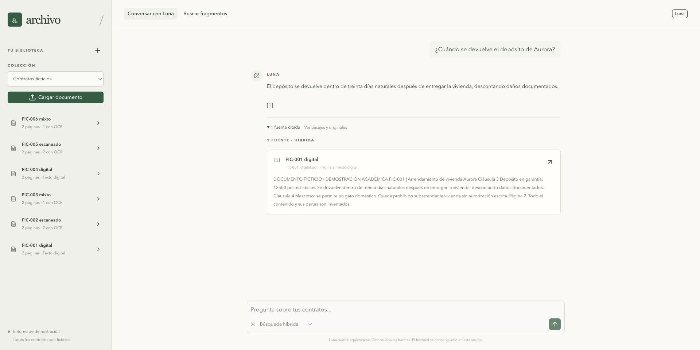
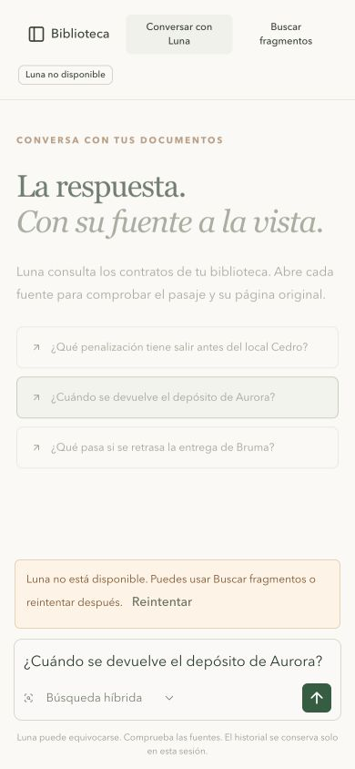

# Verificación del chat MVP de Luna

2 de noviembre de 2026, America/Mexico_City. Ejecución local real con OpenAI Responses y `gpt-6-luna`, usando únicamente contratos ficticios. No se simularon respuestas del proveedor ni se cargaron archivos en otro Vector Store.

## Recorrido HTTP

El [recibo inicial](luna_http_inicial.json) conserva las primeras respuestas y un fallo de recuperación de SIM0170: la consulta generada era larga y recuperó otros contratos; Luna respondió sin evidencia. Se ajustaron las instrucciones de la herramienta para formular búsquedas cortas, conservando folio y concepto. No se modificaron pgvector, fragmentación ni filtros.

El [recibo posterior](luna_http_final.json) conserva el mismo caso después del ajuste y los controles siguientes:

| Caso | Resultado observado | Fuente |
| --- | --- | --- |
| SIM0170, reparaciones | 5100 pesos ficticios por evento; aprobación escrita para gastar más. | PDF mixto, página 4, OCR intrapágina. |
| Cedro, salida anticipada | Aviso de 60 días y dos mensualidades. Utilizó también la renta de 18000 para calcular 36000; el cálculo no es una cita literal. | PDF mixto, páginas 1 y 2. |
| Seguimiento «¿Y con cuánto tiempo debo avisar?» | Conservó el referente Cedro y respondió sesenta días. | PDF mixto, página 2. |
| Bruma, entrega tardía | 1500 pesos ficticios por día, hasta veinte días. | PDF escaneado, página 2. |
| Aurora, devolución de depósito | Treinta días naturales, descontando daños documentados. | PDF digital, página 2. |
| Contrato inexistente del castillo lunar | Respuesta de evidencia insuficiente, sin fuentes. | No se presentó un vecino como respaldo. |

Los cinco casos documentales recuperaron el archivo y página previstos. Los pasajes devueltos se cotejaron con el texto de esas páginas mediante HTTP. La pregunta sin evidencia produjo primero **503 `LUNA_NO_DISPONIBLE`** en esta ronda; un reintento manual respondió 200 sin fuentes. Se conserva el error, no se atribuye una causa no identificada ni se afirma disponibilidad perfecta. El código no reintenta automáticamente.

Cuatro negativos adicionales: acceso sin clave local devuelve 401; pregunta vacía, rol `system` e historial de siete mensajes devuelven 422. Esas entradas se rechazan antes de llamar al proveedor.

Después se repitió el recorrido completo del servicio: **78/78 comprobaciones correctas**, incluidas CRUD, OCR y errores. El nuevo [recibo HTTP](servicio_http_luna.json) se conserva aparte del histórico. Se exportó OpenAPI de la API en ejecución, con once operaciones y ejemplos del chat. Pasaron los checks de lock, Ruff y build del repositorio y backend; frontend pasó lint, typecheck y build.

## Navegador

En Chrome, desde Nuxt, se preguntó por Aurora y Luna respondió treinta días con referencia `[1]`. Se desplegó la fuente y se comprobó archivo, página 2 y texto literal. La interfaz mostró primero consulta en curso y después Luna disponible.

En un viewport temporal de 390 por 844 se comprobó el aviso sin clave, conservación de la pregunta, botón de reintento y acceso a búsqueda directa. La búsqueda local de Aurora recuperó la página 2. Se abrió y cerró la biblioteca móvil y se restauró el viewport original.

## Instalación sin clave

Se arrancó `motor-documental-sin-luna` con imágenes locales, volúmenes nuevos y el archivo de ejemplo vacío, en puertos alternativos. No se reconstruyeron imágenes ni se reutilizó una base previa. Se cargaron seis contratos; web y búsqueda devolvieron 200; el chat devolvió 503 `LUNA_NO_CONFIGURADA`. Ver [recibo](luna_sin_clave.json). Esa instancia de verificación se detuvo conservando sus volúmenes.

La inspección de montajes comprobó que solo API tiene `/run/secrets/luna_api_key`. La clave del proveedor no apareció en el HTML inspeccionado. La clave real permanece en un archivo privado externo al repositorio; no se incluye en los recibos ni en la entrega.

## Límites

Este recorrido pequeño comprueba conexión, uso de la herramienta, ejemplos de fidelidad, falta de evidencia y errores. No es una evaluación amplia de respuestas, seguridad multiusuario ni calidad jurídica. El benchmark anterior de 68 casos y 612 peticiones sigue midiendo recuperación sin LLM. Las citas validadas por índice no garantizan por sí solas la corrección semántica.
